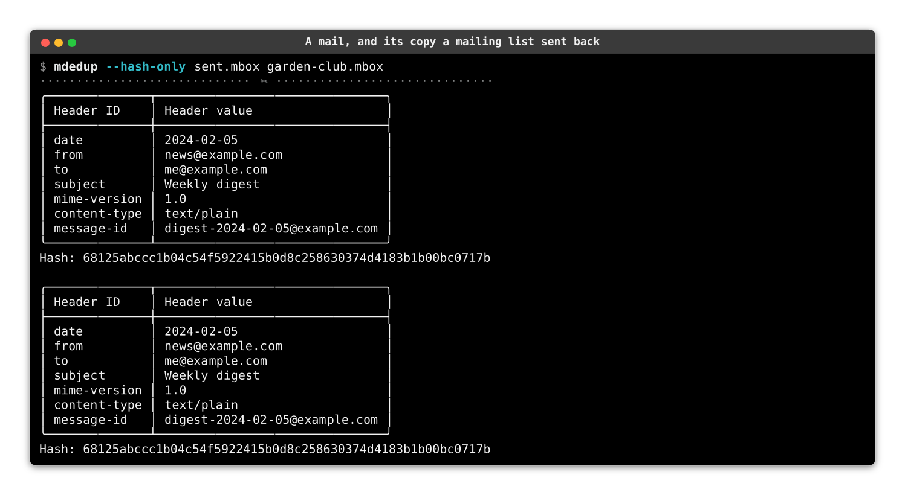
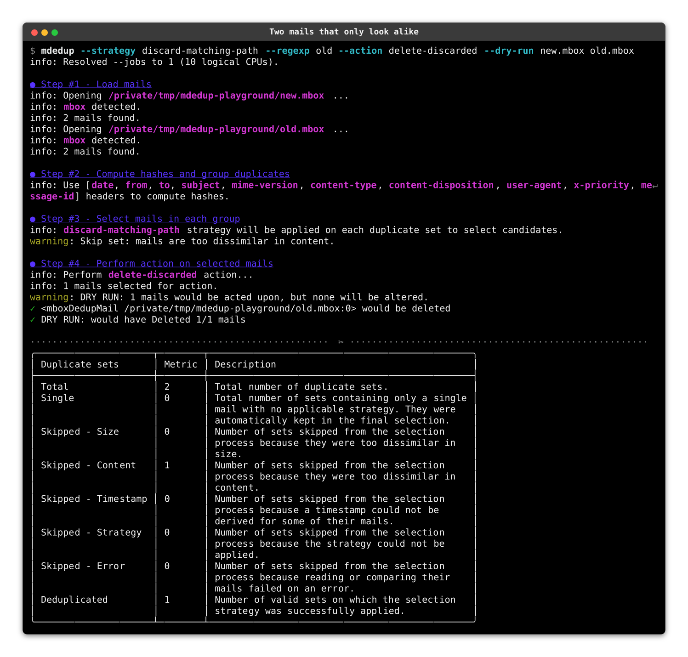
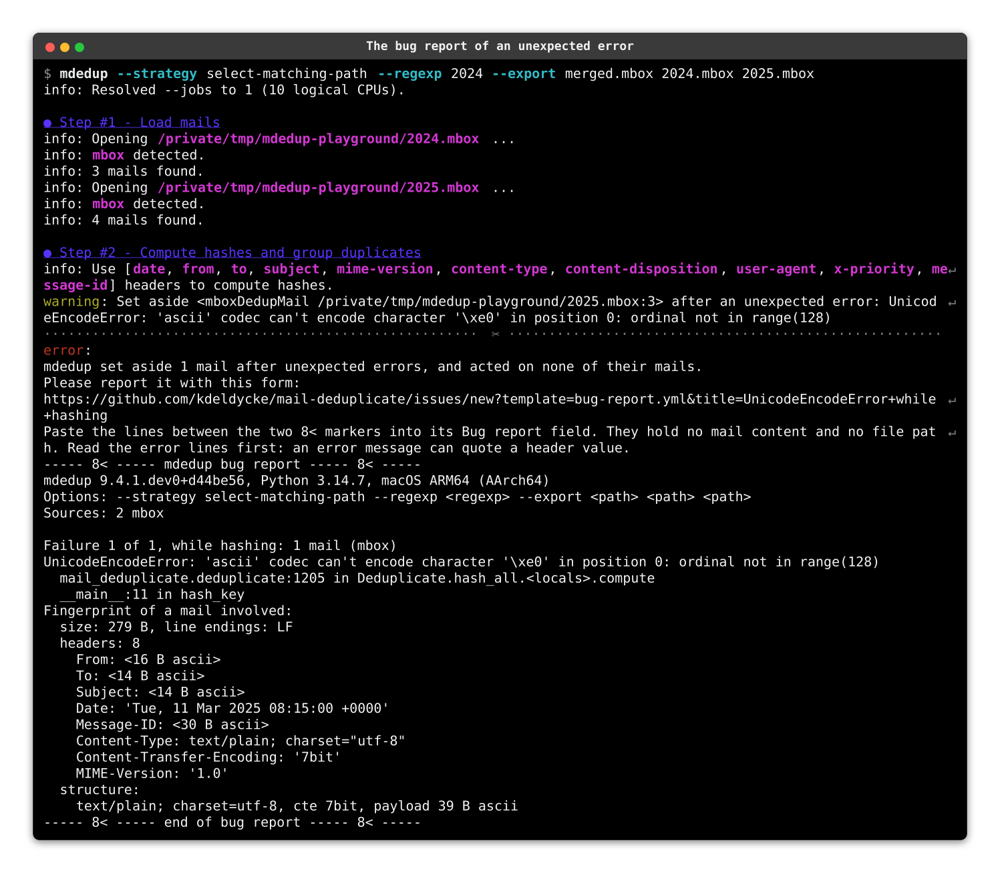

# {octicon}`light-bulb` Design

This CLI reads mails, then automatically detects, regroup and act on duplicates.

Process:

- Step #1: load mails from their sources.
- Step #2: compute the canonical hash of each mail based on their headers (and optionally their body), and regroup mails sharing the same hash.
- Step #3: apply a selection strategy on each subset of duplicate mails.
- Step #4: perform an action on all selected mails.
- Step #5: report statistics.

For added protection against accidentally removing mails due to false positives, we introduced several safeguards along the processing steps which can be configured via CLI options.

## Step 1: Loading mails

Mails are loaded from a variety of mailbox formats (`maildir`, `mbox`, `babyl`, `mh`, `mmdf` and `eml`).

## Step 2: Hashing

In theory, we could rely on the mail's `Message-ID` as a key to identify duplicate mails.

The reality is messier. There is no guarantee that `Message-ID` is unique or even present. Yes, certain broken mail servers which must remain nameless are guilty of this. 😩

That is why `mdedup` propose to identify uniqueness of mails based on an ordered hashed list of headers.

Hashing is done by cherry-picking certain headers, in some cases doing some minor tweaking of the values to reduce them to a canonical form, and then computing a hash of those headers concatenated together.

The list of headers to consider can be set with the `-h`/`--hash-header` option.

```{tip}
You can use `Message-ID` as the sole reference header by passing `--hash-header Message-ID` to the CLI.
```

Once a mail is hashed it is dehydrated: its parsed message is dropped, and only its identity, its source box and a few memoized scalars are retained. Even its own location is derived from its box on demand rather than stored. The steps below re-read from the source box whatever content they need, so the memory held for the rest of the run amounts to about 600 bytes per mail, whatever the size of the boxes.

### Default headers and mailing lists

The [default headers](https://kdeldycke.github.io/mail-deduplicate/mail_deduplicate.html#mail_deduplicate.cli.DEFAULT_HASH_HEADERS) used for hashing are currently set to:

- `Date`
- `From`
- `To`
- `Subject`
- `MIME-Version`
- `Content-Type`
- `Content-Disposition`
- `User-Agent`
- `X-Priority`
- `Message-ID`

This set was crafted to limit the effects of mailing-lists on both the mail headers and body, including:

- having an extra footer in the mail's body, thus changing the `Content-Length` header;
- mails with a new path described by the `Received` headers which would not be contained in any copy of the mail saved locally at the time it was sent to the list;
- munging the `Reply-To` header even though it's a bad idea;
- adding plenty of other random headers which a copy saved locally at sending-time would not have, such as `X-Mailman-Version`, `Precedence`, `X-BeenThere`, `List-*`, `Sender`, `Errors-To`, and so on;
- adding a prefix to the `Subject` header.

`--hash-only` prints what each mail hashes to, without selecting or acting. Here a mail as it was sent, and the copy a mailing list sent back with a `[garden-club]` subject prefix, its own headers and an unsubscribe footer, reduce to the same canonical headers and the same hash:

```shell-session
$ mdedup --hash-only sent.mbox garden-club.mbox
```



### ❎ Safeguard: minimal headers

To avoid hashing mails with too few headers (like corrupted mails), a minimal number of the selected headers must be present in a mail before its hash is trusted.

This floor is derived automatically as the smaller of **4** and the number of headers selected via `--hash-header`. The default ten-header set therefore requires at least four to be present, while narrowing the selection down to a single header relaxes the floor to match, so no dedicated option is needed.

### Reusing hashes between runs

Hashing the same mail with the same options always produces the same result, so `--cache` keeps those results in a local database and lets a later run skip reading and parsing the mails it has already seen. Its invalidation rules and the cost of each hashing option are covered in [](performance.md).

## Step 3: Selecting duplicates

Once all mails have been hashed, mails with the same hash are grouped together as duplicates. Then a selection strategy is applied to each group of duplicates to select which mails will be acted upon.

Several strategies can be chained into a fallback cascade by repeating the `--strategy` option. Each group is submitted to the first strategy, and handed over to the next each time a strategy fails to discriminate its mails: because it selected all of them, none of them, or could not compare mails missing a timestamp. The group is only skipped once the whole cascade is exhausted. A cascade ending with one of the random strategies, which always succeed, resolves the byte-identical copies that time-based and size-based criteria cannot tell apart.

### ❎ Safeguard: size threshold

Sets of duplicates are verified by comparing the body sizes of the mails they contain, and two mails differing by more than a threshold are not considered copies of each other.

Since we're ignoring the `Content-Length` header by default [because of mailing-list effects](https://kdeldycke.github.io/mail-deduplicate/design.html#default-headers-and-mailing-lists), we introduced a limit on the allowed difference between the sizes of the message payloads.

If this threshold is exceeded, this could point to message corruption somewhere, or a false positive. The mails involved in the most offending pairs are then set aside with a warning naming them, so a single outlier does not prevent the deduplication of the true copies sharing its set. Every mail still acted upon is within the thresholds of all the other mails of its reduced set. When fewer than 2 similar mails remain, there is nothing coherent left to deduplicate and the whole set is skipped, with a warning.

```{caution}
Headers are not counted towards this threshold, because many [headers can be added by mailing list software](https://kdeldycke.github.io/mail-deduplicate/design.html#default-headers-and-mailing-lists) such as `mailman`, or even by the process of sending the mail through various MTAs.

One copy could have been stored by the sender's MUA prior to sending, without any `Received` headers, and another copy could be reflected back via a `CC`-to-self mechanism or mailing list server.

This threshold has to be large enough to allow for footers added by mailing list servers.
```

The default size threshold is **512 bytes**, and can be changed via the `--size-threshold` option. Set it to `0` to demand copies of exactly the same size, or to `-1` to drop the check. Dropping it leaves the hash as the only evidence that two mails are copies.

### ❎ Safeguard: content threshold

Similarly to the size threshold, we generate unified diffs of duplicates and ensure that the diff is not greater than a certain size to limit false-positives.

The default content threshold is **768 bytes**, and can be changed via the `--content-threshold` option. Its `0` and `-1` values mean what they mean for the size threshold.

Here two boxes hold a real duplicate, and two mails that share every hashed header, `Message-ID` included, but not their body. The dry run deletes the duplicate, and skips the other set, which the `Skipped - Content` row counts:

```shell-session
$ mdedup --strategy discard-matching-path --regexp old --action delete-discarded --dry-run new.mbox old.mbox
```



## Step 4: Performing actions

Once duplicates have been selected, an action is performed on them.

The `copy-*` and `move-*` actions write each mail into the export box as the bytes its source box holds, never as a message rebuilt from its parsed form. Python's `email` generator redraws multipart boundaries, closes a boundary left open, turns a bare CR into a line break, and drops the content of a multipart part it parsed with no subpart: a deduplication is no reason to repair a mail. Line endings are the one conversion left. A mail is written with LF endings, which every format but `eml` turns into the line separator of the platform. An `mbox` or `mmdf` box also quotes the body lines starting with `From `, as its format requires.

What a format keeps beside a mail travels with it into a box of the same format: the envelope `From ` line of an `mbox` or `mmdf` mail, the `new` or `cur` folder, the flags and the modification time of a `maildir` mail, and the sequences of an `mh` mail. A box of another format has no place for them, and nothing is translated: a `maildir` mail copied into an `mbox` gets no `Status` header, and loses its flags. The labels of a `babyl` mail are not carried.

### Reading a strategy against an action

A strategy names the half of each set it selects, and an action names the half it applies to. The two are chosen apart, so read them together before running anything destructive.

`--strategy select-newest --action delete-discarded` keeps the newest copy of each set and removes the others. Swapping the action for `delete-selected` removes the newest copy and keeps the others. Both are valid requests, and only one of them is usually the intended one. The same holds for the `discard-*` strategies, which name the opposite half: `--strategy discard-newest --action delete-selected` also keeps the newest copy.

`--dry-run` reports what either pairing would do without touching a mail, which settles the question in one run.

### Mails without duplicates

A mail alone in its duplicate set has no copy to be compared to, so no strategy ever rules on it. It is kept, and belongs to the selection the `*-selected` actions target: this is what makes `--action copy-selected` and `--action move-selected` produce a box holding the whole deduplicated corpus, and not its duplicates only.

`--action delete-selected` is the one exception, and leaves those mails in place. Deleting one removes the only copy of it there is, and nothing was written anywhere else first. The deletion therefore applies to the mails a strategy really picked, and the run warns how many mails it left untouched before acting.

### Hardlinking duplicates

`--action hardlink-discarded` is the one action that neither removes a mail nor writes it somewhere else: each discarded mail stays in its folder, under its own name, but the file backing it is replaced by a hardlink to the copy kept in its own duplicate set. The copies then share a single file on disk, and the space the others took is reclaimed.

This is aimed at the same mail reaching several accounts or folders, where each copy carries the headers it collected on its own way in. Files that are already identical byte for byte are the province of general-purpose tools like [`duperemove`](https://github.com/markfasheh/duperemove) or [`hardlink`](https://jak-linux.org/projects/hardlink/), which scan a whole filesystem. What those cannot decide is whether two files that differ are the same *mail*: that is the question the hashing and selection steps above answer.

Two properties make this safe to run on a live mail store:

- The link is created under a temporary name in the mail's own directory and then renamed over it. The rename is atomic and stays on one filesystem by construction, so the mail is never missing from its box, whatever interrupts the run.
- The mail keeps its file name, which is where `maildir` records its flags. The same mail can stay read in one folder and unread in another while both share one file.

A mail is left untouched, and counted apart in the report, when it comes from a file-based box (`mbox`, `babyl` and `mmdf` pack every mail into the box's single file, so none has a file of its own to link), when it already shares the file of the copy kept, or when it sits on another filesystem. Re-running over an already-linked box is therefore a no-op.

By default only copies that are identical byte for byte are linked. Linking a mail that differs swaps its content for the kept copy's, which reads as a deduplication but is really a rewrite: whatever was unique to that copy is gone, and nothing on disk records that it changed. That is the interesting case for mails delivered to several accounts, so `--hardlink-differing` enables it, as a deliberate choice rather than a default. The size and content thresholds described above still gate which mails reach this step at all.

```{caution}
Linked mails share one inode, and so share the permissions, ownership and modification time of the copy kept. A mail client that rewrites a mail in place rather than replacing it, which the `maildir` specification tells it not to do, would alter every copy at once.
```

## Errors and bug reports

A problem you can fix ends the run with a one-line `Error:` message and exit code `1`: a source with no structure `mdedup` recognizes, a box another program locked, a source given twice, an export box that already exists, or a system error, like a missing permission or a full disk, while `mdedup` opens a source or acts on the mails. The first four stop the run before `mdedup` touches any mail. A system error in the action step can come after the action handled some mails. Its message names the mail it stopped on, and the mails already handled stay handled.

An error `mdedup` has no rule for is a bug, either in its code or in how it handles a mail shape it never met. What happens next depends on the step:

- In the hashing and selection steps, `mdedup` sets aside the mail or the duplicate set that raised the error, and goes on with the others. No action touches what it set aside. The `Failed` and `Skipped - Error` rows of the statistics count them, and the run ends with a bug report and exit code `1`.
- In the action step, `mdedup` stops at the first such error, as a move or a deletion must not go on past a mail it cannot explain. It logs the mail the action was working on and the full traceback, then prints the same bug report.
- When the statistics self-check finds counts that do not add up, the run ends with exit code `115` and a bug report.

The bug report links to the [bug report form](https://github.com/kdeldycke/mail-deduplicate/issues/new?template=bug-report.yml), with a title like `UnicodeEncodeError while copying` filled in. It holds a block to paste into the form. The block gives the version of `mdedup`, Python and the platform, the options of the run, and the formats of its sources. A development version names its commit, as `mdedup --version` does. Then comes the error, with its traceback reduced to module names, line numbers and function names, and a fingerprint of the mails involved. In the hashing and selection steps, `--verbosity DEBUG` also logs the full traceback of each failure the report details.

Here is the end of a run whose hashing step met such an error. The error was forced on purpose, on the mail with the `Password reset` subject, to show the report. The forced function is the `__main__` line of its traceback:



A fingerprint describes the structure of a mail, never its content:

- its size and line endings,
- the name of each header,
- the value of `Date`, `MIME-Version` and `Content-Transfer-Encoding`, and the type and structural parameters of `Content-Type` and `Content-Disposition`,
- the shape of every other header value: its length, its kind of bytes, its folding and its encoded words,
- the MIME tree, with the type, charset, transfer encoding and kind of bytes of each part, the preamble and epilogue of each multipart, and the defects the parser found.

```{hint}
A path, a regular expression, an address, a subject, a body and a file name never reach the block. Read it before you post it all the same: an error message can quote a header value.
```
