# {octicon}`zap` Performance

How long a run takes, how much memory it holds, and how to make the next run faster.

Every timing below comes from one batch of runs of `mdedup` `9.5.0` on Python 3.14, on an Apple M1 Pro with an SSD, over a synthetic maildir of 20,000 mails of about 4 KB each, one fifth of them exact copies of another. Each figure is the median of ten runs, interleaved with the runs of every other figure, with the output piped away. The seconds depend on the machine, so read the proportions and the ratios rather than the seconds themselves. Counts of mails read are exact, and depend on your corpus alone. `docs/performance_update.py` builds the corpus and runs the batch again.

## Where a run spends its time

Hashing dominates a first run, and the [hash cache](#reusing-hashes-between-runs) is the only thing that skips it. What is left over then becomes the bulk of the work:

| Step                    | First run  | With a warm cache | What it does                                                    |
| ----------------------- | ---------- | ----------------- | --------------------------------------------------------------- |
| 1. Loading mails        | 0.1s ( 2%) | 0.1s ( 4%)        | Lists each box. Cheap, but grows with the number of subfolders. |
| 2. Hashing              | 5.2s (78%) | 0.4s (13%)        | Reads and parses every mail.                                    |
| 3. Selecting duplicates | 1.0s (15%) | 2.0s (71%)        | Re-reads the body of every mail sharing its hash with another.  |
| 4. Performing actions   | 0.3s ( 5%) | 0.3s (12%)        | Writes, for every action but `delete-*` on the source box.      |
| **Total**               | **6.6s**   | **2.8s**          |                                                                 |

The cache cuts hashing by a factor of fourteen, yet the run as a whole gets only 2.4 times as fast, because the cache does not cover step 3. Step 3 even takes twice as long: an uncached run finds the mails in the file cache of the operating system, as hashing has just read them, while a cached run reads them from disk. It grows from about a sixth of the run to more than two thirds of it.

Step 3 is worth understanding: a mail is [dehydrated](design.md) once hashed, so with the default `--hash-body skip`, comparing it against `--size-threshold` and `--content-threshold` reads its body again from its box. Only mails sharing their hash with another are compared, so the cost tracks how many duplicates you actually have. On this corpus that is **8,000 of the 20,000 mails read a second time**, a count that does not depend on your hardware and is the number to reason about.

How many *copies* land in one set matters less than it looks. The thresholds are settled over the whole set before any pair is examined, and two mails carrying the same body are compared once however many of them there are, so a set of 200 identical copies costs about what a set of two does.

### Skipping the threshold comparisons

Both thresholds exist to catch mails that hash alike without being copies, so turning them off means acting on a set that was never checked. When you trust your hash, `-1` disables either one, and the re-reads go with them:

| Warm run, `--hash-body skip`   | Total | Mails re-read |
| ------------------------------ | ----- | ------------- |
| Default thresholds             | 2.8s  | 8,000         |
| `--content-threshold=-1` alone | 2.8s  | 8,000         |
| Both set to `-1`               | 0.9s  | 0             |

That middle row is the surprise: dropping the content check alone changes nothing under the default `--hash-body skip`. A mail's size is the byte length of its decoded body, and skip mode never reads bodies while hashing, so the *size* check drags them back on its own.

Hash the body with `decoded` and the second pass goes away on its own. Every mail of a set then shares the decoded text that was hashed, so both thresholds are settled without reading a mail again. So do `--raw-headers` and `--hash-body raw` together, which the conservative preset sets: their sets hold identical bytes. Under `raw`, copies share their bytes but can still differ in their transfer encoding or charset. Under `normalized`, copies can still differ in their whitespace. In both modes the thresholds still compare the copies, and the bodies are read again.

## Memory

A mail is reduced to a lightweight stub as soon as it is hashed, so memory tracks the *number* of mails rather than their size. About **600 bytes are retained per mail**, which a run's transient allocations round up to roughly 1 KB of resident memory.

| Mails  | Box size | Peak resident memory |
| ------ | -------- | -------------------- |
| 1,500  | 215 MB   | 46 MB                |
| 20,000 | 79 MB    | 65 MB                |
| 60,000 | 235 MB   | 109 MB               |

The fixed baseline is around 43 MB of interpreter and imports, so a collection of 300,000 mails lands near 375 MB. Large enough collections can still reach the limits of your machine, in which case [`mdedup` exits abruptly](https://github.com/kdeldycke/mail-deduplicate/issues/362#issuecomment-1266743045), zapped by your OS's [OOM killer](https://en.wikipedia.org/wiki/Out_of_memory). Re-reading mail content also costs extra disk I/O, so your mileage varies with your hardware.

```{tip}
Deduplicating one box at a time keeps the peak lower than passing every box in a single run, since mails are only grouped across the sources of the same run.
```

## What a run says

At its default verbosity a run reports its steps, the strategies in play, and anything it had to skip, then closes with the statistics tables. Individual mails and duplicate sets are named at `--verbosity DEBUG` only: a corpus has as many sets as it has distinct mails, and narrating each one costs more than deciding it. The action step is the exception: it prints a `✓` line for each mail it handles, at any verbosity.

```{tip}
Output costs little. In a terminal, a run whose hashes all come from the cache takes within a few percent of the same run with its output piped away, which is no more than the noise between two runs. `--verbosity WARNING` trims the log to what went wrong.
```

## Running in parallel

`--jobs` hands both of the expensive steps to worker processes. Hashing goes out a mail at a time, and selection a duplicate set at a time, since sets share nothing with one another. Workers open the files themselves and send back only what was decided, so no mail ever crosses between processes.

| Step                    | `--jobs=1` | `--jobs=4` |
| ----------------------- | ---------- | ---------- |
| 2. Hashing              | 5.2s       | 1.7s       |
| 3. Selecting duplicates | 1.0s       | 0.5s       |
| **A first run**         | **6.6s**   | **2.6s**   |
| **A cached second run** | **2.8s**   | **1.6s**   |

A first run gains most, since hashing is the bulk of it and parallelizes best: `3.1x` on that step with the default `--hash-body skip`, `3.0x` with `decoded` and `3.2x` with `normalized`. Once the [cache](#reusing-hashes-between-runs) has removed the hashing, what remains is mostly the selection, and a cached run gains `1.7x`.

Returns shrink past four jobs: eight jobs hash `4.2x` faster than one, against `3.1x` for four.

```{important}
Processes, not threads. Both steps are Python-level work, which the interpreter lock serializes, so spreading them over threads only adds contention: hashing measured at `0.88x` to `0.97x`, an outright loss, before this became a process pool.
```

Work is handed out a window at a time rather than all at once, so a parallel run holds no more per-mail state than a sequential one. Sets of a single mail are settled without leaving the main process: there is nothing to compare, and shipping one would cost more than deciding it.

```{note}
A parallel run keeps the same mails as a sequential one. Every strategy is determined by the mails alone, `select-one` and `discard-one` included: both rule on the copy whose path sorts first.
```

Two limits are worth knowing. Only folder-based boxes (`maildir`, `MH`, `eml`) can be shared out, because their mails each own a file; the mails of an `mbox` and its kin are byte ranges of a single file that one handle seeks through, so a run over them stays sequential whatever `--jobs` says. And starting workers costs around 50 ms, which a small box never earns back: below a thousand mails or so, leave `--jobs` at `1`.

If a pool cannot be started at all, which happens in some sandboxed environments, the run says so and does the work in-process instead.

## Reusing hashes between runs

The same mail, hashed with the same options, always produces the same result. `--cache` keeps those results in a local SQLite database so a later run skips reading and parsing the mails it has already seen.

```shell-session
$ mdedup --cache --strategy select-newest --action delete-discarded ~/Maildir
```

On the 20,000-mail corpus, a second run takes less than half the time of an uncached one, `2.8s` against `6.6s`, and its hashing step alone is fourteen times faster. The first run costs about 5% more than an uncached one, which is the price of filling the database.

It is off by default. `--cache-path` points at another database and enables it on its own.

The two recordings below run the same command twice on a `maildir` of 20,000 mails, with `--hash-body normalized` so hashing reads every body. The first run fills `cache.db`, and the second reads its hashes back:

```shell-session
$ mdedup --hash-body normalized --cache-path cache.db --strategy select-one --action delete-discarded Archive
```





### What invalidates an entry

Two independent guards decide whether an entry can still be trusted.

**The options feeding the hash.** `--hash-header`, `--hash-body` and `--time-source` are fingerprinted together. Changing any of them discards the whole database, since an entry produced under different options cannot be told apart from a valid one. An upgrade of `mdedup` that changes how a hash or a size is computed discards it the same way.

**The file backing the mail.** Its size and modification time are recorded, and re-checked before the entry is used. What this covers depends on the box structure:

- Folder-based boxes (`maildir`, `MH`, `eml`) give each mail its own file, so the key tracks that mail alone. Editing one mail invalidates only that mail. Maildir flag changes, like marking a mail read, rename the file but keep its identity, so they do not needlessly invalidate anything.
- File-based boxes (`mbox`, `babyl`, `mmdf`) pack every mail into the box's single file, and identify them by byte offsets that shift as soon as a mail is added or removed. Any edit to the box therefore invalidates all of its mails at once.

Mails rejected for having [too few headers](design.md) are never cached, as that verdict depends on more than the hash.

### Dry runs fill the cache

`--dry-run` writes to the cache like any other run. This is deliberate, and it is the recommended way to work:

```shell-session
$ mdedup --cache --strategy select-newest --action delete-discarded --dry-run ~/Maildir
$ mdedup --cache --strategy select-newest --action delete-discarded ~/Maildir
```

Previewing what a run would do is exactly when you want to inspect the report, adjust your options and try again. Because the preview has already paid for the hashing, every subsequent run over the same mails is fast, including the real one. Nothing about the mails is modified: the cache lives outside your mail boxes.

```{caution}
The cache only ever spares the hashing step. It does not reduce memory, and it does not spare the body comparisons of step 3.
```

### Managing the database

The database sits in your platform's cache directory:

| Platform              | Location                                                                              |
| --------------------- | ------------------------------------------------------------------------------------- |
| macOS                 | `$XDG_CACHE_HOME/mdedup/hashes.db`, defaulting to `~/Library/Caches/mdedup/hashes.db` |
| Linux and other POSIX | `$XDG_CACHE_HOME/mdedup/hashes.db`, defaulting to `~/.cache/mdedup/hashes.db`         |
| Windows               | `%LOCALAPPDATA%\mdedup\Cache\hashes.db`                                               |

Run `mdedup --help` to see the resolved path on your machine. It holds about 110 bytes per mail, so 20,000 mails cost around 2.2 MB.

It prunes itself as it goes, so it tracks your mails rather than growing forever. Every run drops the entries of mails that disappeared from the boxes it opened, and the entries of every box that is no longer on disk at all. The count is reported at the end of the hashing step:

```text
Hash cache: 19982 mails restored, 18 hashed and recorded, 143 stale entries dropped.
```

Boxes you did not pass on the command line are left alone: their mails are missing from a run's sightings because nobody looked, which is no evidence that they are gone.

Pruning frees space inside the database for later entries, but does not hand it back to your filesystem, so the file never shrinks on its own. Deleting it is always safe, and the next run rebuilds whatever it needs:

```shell-session
$ rm ~/.cache/mdedup/hashes.db
```

Nothing about the cache can take a run down. A database that cannot be opened, on a read-only or full filesystem for instance, is reported as a warning and skipped, and the run hashes every mail as it would without `--cache`. One that cannot be written at the end, because another run holds it or the disk filled up, costs only the next run its head start: by then the deduplication has already produced its results.

### Runs sharing a database

Several runs can point at the same database. They only contend on the single write burst each performs when its hashing step ends, which SQLite serializes: a run that finds the database busy waits up to 30 seconds for it, then gives up on writing and carries on. Reads never block.

## Body hashing

`--hash-body` decides whether mail bodies take part in the hash, and it is the single biggest lever on hashing cost after the cache. This table times each mode in the same batch, relative to `skip`: the hashing step alone, and a whole first run.

| Mode         | Hashing step | Whole first run | Notes                                                                                |
| ------------ | ------------ | --------------- | ------------------------------------------------------------------------------------ |
| `skip`       | `1.00x`      | `1.00x`         | The default. Headers alone are usually enough to identify duplicates.                |
| `raw`        | `1.21x`      | `1.17x`         | Hashes the body bytes as the box holds them, line endings aside. Decodes nothing.    |
| `decoded`    | `1.10x`      | `0.94x`         | Hashes the body with its transfer encodings undone and its text decoded.             |
| `normalized` | `1.43x`      | `1.33x`         | Strips line breaks and spaces first, catching copies that differ only in whitespace. |

Reach for `raw`, `decoded` or `normalized` when header-based hashing groups mails you do not consider duplicates, rather than as a default. `raw` groups the copies that are the same bytes. `decoded` hashes slower than `skip`, yet makes a whole run cheaper on this corpus, where two mails in five have a copy: step 3 then settles the thresholds without reading a mail again.
