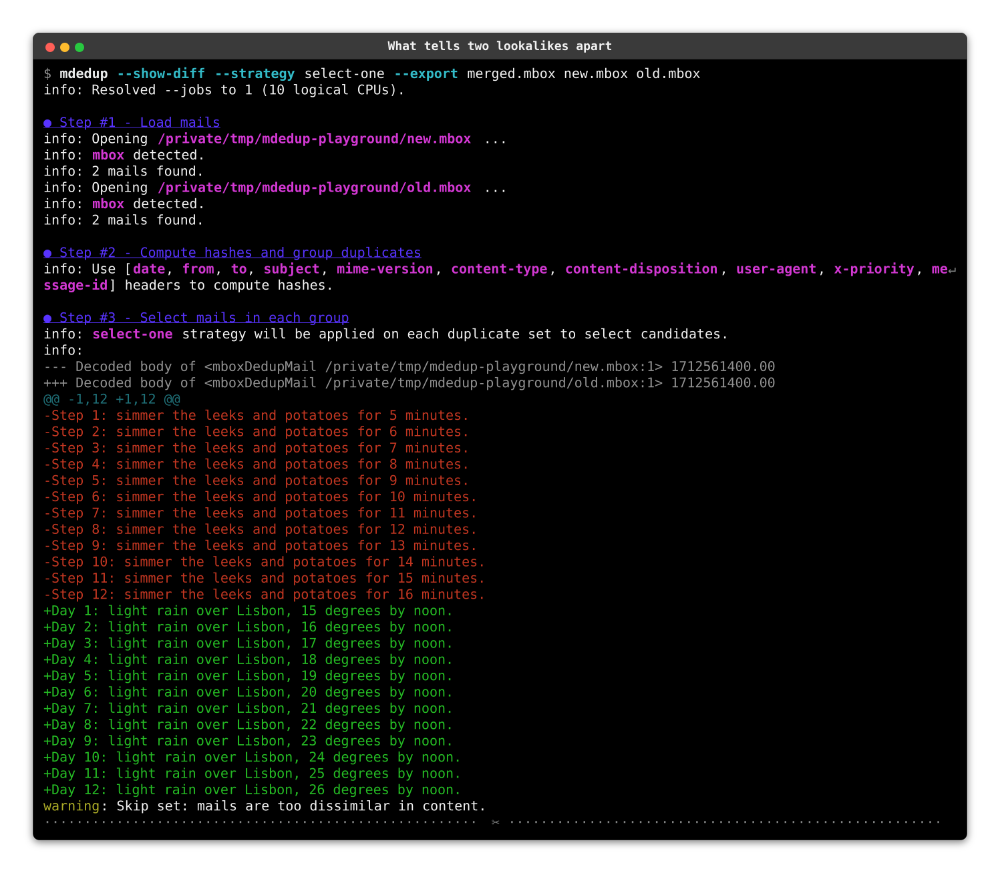

# {octicon}`mortar-board` Tutorial

This page walks through a complete deduplication run on two tiny mail boxes built for the occasion, so you can rehearse every command in a sandbox before pointing `mdedup` at your precious archives. Every `mdedup` output below is captured live while building this page, so what you read is exactly what the documented version does: the commands run from a scratch folder, whose absolute path shows up in the outputs. The one picture on this page, in the safety nets section, is a recording kept in the repository.

## Where duplicates come from

Duplicate mails are rarely typed twice: they are copies accumulated by the tools around them.

- Backups of the same account taken at different times, each holding a copy of the older mails.
- Per-folder or per-label exports, where a mail filed under several labels lands in several boxes.
- Archives consolidated from multiple clients or machines over the years.
- IMAP synchronization accidents, where an interrupted or misconfigured sync re-uploads mails.
- Mailing lists reflecting back mails you also keep in your sent box, slightly altered by footers or subject prefixes.

The first four mostly leave copies that are identical byte for byte, which the first pass below catches without interpreting anything. The last one is why `mdedup` does not stop at comparing bytes: it can also group mails by a hash of a [curated set of headers](https://kdeldycke.github.io/mail-deduplicate/design.html#default-headers-and-mailing-lists), so two copies can differ in transport details and still be recognized as the same mail.

## Build a playground

Save this script as `make_playground.py`. It creates two overlapping `mbox` archives, mimicking two backups of the same account taken a year apart:

```{click:source}
:hide-source:
import os
import tempfile

# Play the whole tutorial session from a scratch folder, like the reader would.
# The original directory is restored by the last hidden block of this page.
_original_cwd = os.getcwd()
os.chdir(tempfile.mkdtemp(prefix="mdedup-tutorial-"))
```

```{click:source}
import mailbox
from email.message import EmailMessage


def make_mail(subject, date, msg_id, body):
    mail = EmailMessage()
    mail["From"] = "news@example.com"
    mail["To"] = "me@example.com"
    mail["Subject"] = subject
    mail["Date"] = date
    mail["Message-ID"] = msg_id
    mail.set_content(body)
    return mail


# Two mails present in both archives: these are the duplicates.
shared = [
    make_mail(
        "Weekly digest",
        "Mon, 05 Feb 2024 09:00:00 +0000",
        "<digest-2024-02-05@example.com>",
        "This week's news.\n",
    ),
    make_mail(
        "Server maintenance window",
        "Wed, 03 Apr 2024 17:30:00 +0000",
        "<maintenance-2024-04-03@example.com>",
        "The server will be down on Friday.\n",
    ),
]

# One mail kept twice, as it was sent and as a mailing list delivered it back:
# a copy too, with a subject prefix, the list's header and a footer.
sent = make_mail(
    "Garden club digest",
    "Fri, 10 May 2024 10:00:00 +0000",
    "<garden-2024-05-10@example.com>",
    "This month: plums and quinces.\n",
)
reflected = make_mail(
    "[garden-club] Garden club digest",
    "Fri, 10 May 2024 10:00:00 +0000",
    "<garden-2024-05-10@example.com>",
    "This month: plums and quinces.\n"
    "\n--\nUnsubscribe: https://lists.example.com/garden-club\n",
)
reflected["List-Id"] = "<garden-club.lists.example.com>"

# Mails unique to each archive.
only_2024 = [
    make_mail(
        "Invoice January",
        "Wed, 31 Jan 2024 12:00:00 +0000",
        "<invoice-2024-01@example.com>",
        "Your invoice is attached.\n",
    ),
]
only_2025 = [
    make_mail(
        "Weekly digest",
        "Mon, 03 Feb 2025 09:00:00 +0000",
        "<digest-2025-02-03@example.com>",
        "This week's news, a year later.\n",
    ),
    make_mail(
        "Password reset",
        "Tue, 11 Mar 2025 08:15:00 +0000",
        "<reset-2025-03-11@example.com>",
        "Click the link to reset your password.\n",
    ),
]

for path, mails in (
    ("archive-2024.mbox", shared + only_2024 + [sent]),
    ("archive-2025.mbox", shared + only_2025 + [reflected]),
):
    box = mailbox.mbox(path)
    for mail in mails:
        box.add(mailbox.mboxMessage(mail))
    box.flush()
    box.close()
    print(f"{path}: {len(mails)} mails")
```

Run it from an empty working folder:

```shell-session
$ python make_playground.py
archive-2024.mbox: 4 mails
archive-2025.mbox: 5 mails
```

```{click:source}
:hide-source:
# The script above just ran for real: check the boxes match the counts shown.
for _path, _count in (("archive-2024.mbox", 4), ("archive-2025.mbox", 5)):
    _box = mailbox.mbox(_path)
    assert len(_box) == _count
    _box.close()
```

That is 9 mails in total, of which only 6 are distinct. Two traps are laid for naive matchers. The two archives each contain a *different* "Weekly digest" mail, sent a year apart: a deduplicator keying on subjects alone would wrongly collapse them. And the garden club digest is kept twice, as sent and as the list delivered it back: a copy that no comparison of bytes recognizes.

## First pass: the conservative run

Start with `--conservative`. It treats as copies only the mails whose bytes are identical, line endings aside: no header is read, nothing is decoded, no threshold applies. Identical copies are interchangeable, so it keeps the copy of each mail whose path sorts first. The default `copy-selected` action then writes every mail that survives into the `--export` box. The sources are only read, so this run needs no rehearsal:

```{click:run}
from mail_deduplicate.cli import mdedup

result = invoke(mdedup, args=["--conservative", "--export", "first-pass.mbox", "archive-2024.mbox", "archive-2025.mbox"])
assert result.exit_code == 0
assert "Conservative mode" in result.output
assert "7 mails selected for action." in result.output
```

Read the report bottom-up: the two shared mails were found in both archives, the copy of each in `archive-2024.mbox` was selected and the other discarded, and the 2 selected mails were copied to `first-pass.mbox` together with the 5 mails that have no identical copy. 9 mails in, 7 out, and nothing lost: each copy discarded here is the same bytes as the copy kept.

```shell-session
$ grep --count "^From " first-pass.mbox
7
```

```{click:source}
:hide-source:
import mailbox

_first_pass = mailbox.mbox("first-pass.mbox")
assert len(_first_pass) == 7
_first_pass.close()
```

The garden club digest is still there twice, as its two copies differ: the list added a subject prefix, a header and a footer. Whatever a conservative pass leaves behind differs somewhere, and the rest of this page is about seeing through such differences.

```{tip}
The export box defaults to the `mbox` format. Pass `--export-format maildir` to produce a `maildir` folder instead, ready to be dropped on an IMAP server or opened by any client.
```

## Second pass: when copies differ

The conservative pass made four decisions for you. Each is an option of the default run:

- Which headers identify a mail: `--hash-header`, ten of them by default, each reduced to a canonical form. `Date` is kept to its day, and `Subject` loses its `Re:` and `[list]` prefixes.
- Whether the body counts: `--hash-body`, which leaves it out by default.
- How far two copies may differ before they are left alone: `--size-threshold` and `--content-threshold`, measured on the decoded bodies.
- Which copy of a set to keep: `--strategy`, which has no default.

Under those defaults, the two copies of the garden club digest hash alike, and their bodies differ by a footer the thresholds allow. The price is interpretation: a run that sees through differences can be wrong about one, so it deserves a rehearsal before any destructive action, which is what `--dry-run` is for.

### Choose a strategy

A strategy decides, within each set of copies, which mails are *selected* and which are *discarded*. Without one, `mdedup` refuses to guess: every duplicate set is skipped, and only the mails without copies reach the export box. Strategies come in mirrored pairs (`select-oldest` is `discard-newer`, and so on), and in a few families:

- Time-based: `select-oldest`, `select-newest` and friends, comparing dates.
- Size-based: `select-smallest`, `select-biggest` and friends, comparing mail sizes.
- Path-based: `select-matching-path` and friends, testing mail locations against `--regexp`.
- Quantity-based: `select-one` keeps the copy whose path sorts first, and `select-all-but-one` discards it, for when copies are indistinguishable.

The full list, with the exact semantics of each, sits at the bottom of `mdedup --help` and in the [CLI parameters page](https://kdeldycke.github.io/mail-deduplicate/cli.html).

Backup copies of the same mail are usually byte-identical: same `Date` header, same size. Time-based and size-based strategies cannot tell such copies apart, and skip the set as a whole rather than acting on it. That makes `select-one` the right strategy for merging identical copies, and the one `--conservative` applies on its own. It picks the same copy on every run, so a `--dry-run` names the copies the real run keeps.

Strategies can also be chained into a fallback cascade by repeating the option: `--strategy select-oldest --strategy select-one` keeps the oldest copy in the sets where dates differ, and falls back to the copy whose path sorts first in the sets where they do not.

### Merge into a clean box

`--strategy select-one` picks one copy per set, and the default action (`copy-selected`) writes every selected mail to the `--export` box, leaving the sources untouched:

```{click:run}
from mail_deduplicate.cli import mdedup

result = invoke(mdedup, args=["--strategy", "select-one", "--export", "merged.mbox", "archive-2024.mbox", "archive-2025.mbox"])
assert result.exit_code == 0
assert "6 mails selected for action." in result.output
```

Three duplicate sets this time: the two the first pass found, and the garden club digest, whose two copies now share a hash. One copy of each was selected, and the 3 selected mails were copied to `merged.mbox` together with the 3 unique mails. 9 mails in, 6 mails out:

```shell-session
$ grep --count "^From " merged.mbox
6
```

```{click:source}
:hide-source:
import mailbox

_merged = mailbox.mbox("merged.mbox")
assert len(_merged) == 6
_merged.close()
```

Both "Weekly digest" mails made it through, as their different `Date` and `Message-ID` headers put them in different sets.

### Delete duplicates in place

Copying is the safe default, but sometimes you want to prune the originals: say the mails in `archive-2025.mbox` are the canonical ones, and any copy of them lingering in `archive-2024.mbox` should go.

Path-based strategies handle this preference: `select-matching-path` keeps the copies whose location matches `--regexp`, so the `delete-discarded` action removes the copies living elsewhere. Destructive actions deserve a rehearsal first, and `--dry-run` reports what the run would do without touching a mail:

```{click:run}
from mail_deduplicate.cli import mdedup

result = invoke(mdedup, args=["--strategy", "select-matching-path", "--regexp", "2025", "--action", "delete-discarded", "--dry-run", "archive-2024.mbox", "archive-2025.mbox"])
assert result.exit_code == 0
assert "DRY RUN: 3 mails would be acted upon, but none will be altered." in result.output
```

```{click:source}
:hide-source:
import mailbox

# The rehearsal must not have touched any box.
for _path, _count in (("archive-2024.mbox", 4), ("archive-2025.mbox", 5)):
    _box = mailbox.mbox(_path)
    assert len(_box) == _count
    _box.close()
```

Three deletions planned, as expected: the two shared mails and the garden club digest, in their `archive-2024.mbox` incarnation. Do not let the `6 mails selected` line worry you: it counts the mails that will survive, while the action itself only touches the 3 discarded copies. Drop `--dry-run` to proceed:

```{click:run}
from mail_deduplicate.cli import mdedup

result = invoke(mdedup, args=["--strategy", "select-matching-path", "--regexp", "2025", "--action", "delete-discarded", "archive-2024.mbox", "archive-2025.mbox"])
assert result.exit_code == 0
assert "Deleted 3/3 mails" in result.output
```

```shell-session
$ grep --count "^From " archive-2024.mbox
1
$ grep --count "^From " archive-2025.mbox
5
```

```{click:source}
:hide-source:
import mailbox

for _path, _count in (("archive-2024.mbox", 1), ("archive-2025.mbox", 5)):
    _box = mailbox.mbox(_path)
    assert len(_box) == _count
    _box.close()
```

`archive-2024.mbox` is down to its single unique mail, and `archive-2025.mbox` was not touched. Mails without duplicates are never deleted, whatever the strategy and whichever of the two delete actions runs: only members of a duplicate set are.

```{caution}
For folder-based boxes (`maildir`, `mh`, `eml`), `--regexp` is tested against the path of each individual mail file. For file-based boxes (`mbox`, `babyl`, `mmdf`), all mails share the path of the box itself.
```

### Link duplicates instead of deleting them

Deleting a discarded copy frees its space, but the mail also leaves the folder it was in. Sometimes every copy has a reason to stay: the same message delivered to two accounts you sync side by side, or a mail filed under several labels. The `hardlink-discarded` action covers that case. Each discarded mail keeps its name and its folder, and only the file behind it changes: it becomes a hardlink to the copy that was selected, so the copies share a single file and the space the others took is given back.

This needs boxes where each mail owns a file, so `maildir` rather than `mbox`. Reusing the playground's mails, in the same folder:

```{click:source}
import mailbox

# The two shared mails delivered to two accounts synced side by side, each
# account also holding a mail of its own.
for account, mails in (
    ("account-a", shared + only_2024),
    ("account-b", shared + only_2025),
):
    box = mailbox.Maildir(account)
    for mail in mails:
        box.add(mail)
    box.close()
```

That is 7 mails, each stored in a file of its own:

```shell-session
$ find account-a account-b -type f | wc --lines
7
$ find account-a account-b -type f -printf '%i\n' | sort --unique | wc --lines
7
```

```{click:source}
:hide-source:
from pathlib import Path


def _census():
    """Mails on disk, and the distinct files actually backing them."""
    _files = [
        _path
        for _account in ("account-a", "account-b")
        for _path in Path(_account).rglob("*")
        if _path.is_file()
    ]
    return len(_files), len({_path.stat().st_ino for _path in _files})


assert _census() == (7, 7)
```

The path-based strategy from the previous section applies here too: `--regexp account-a` keeps the copies stored under `account-a`, so the `account-b` copies are the ones linked back to them. Rehearse with `--dry-run` as before, then run it for real:

```{click:run}
from mail_deduplicate.cli import mdedup

result = invoke(mdedup, args=["--strategy", "select-matching-path", "--regexp", "account-a", "--action", "hardlink-discarded", "account-a", "account-b"])
assert result.exit_code == 0
assert "Hardlinked 2/2 mails" in result.output
```

```shell-session
$ find account-a account-b -type f | wc --lines
7
$ find account-a account-b -type f -printf '%i\n' | sort --unique | wc --lines
5
```

```{click:source}
:hide-source:
# Same mails, fewer files: the two linked copies no longer have one each.
assert _census() == (7, 5)
```

Still 7 mails on disk, now backed by 5 files: each `account-b` copy shares the file of its `account-a` twin. Both accounts still list everything they held, and each copy keeps its own `maildir` flags, which live in the file name rather than in the file, so the same mail can stay read in one account and unread in the other. Running the command again changes nothing, as copies already sharing a file are reported as such and left alone.

```{caution}
Only copies identical byte for byte are linked by default. Two copies of a mail that reached you by different routes usually differ, if only by a `Received` header, and linking those swaps one copy's content for the other's. `--hardlink-differing` allows it, as a deliberate choice. Mails from `mbox`, `babyl` and `mmdf` boxes are always left alone, having no file of their own to link.
```

```{tip}
`--conservative --action hardlink-discarded` reclaims space without a rehearsal: a conservative run only ever discards identical copies, which are the ones this action links by default.
```

## Safety nets

Several safeguards run before any mail is acted upon, each detailed in the [design page](https://kdeldycke.github.io/mail-deduplicate/design.html). None of them has anything to check under `--conservative`, whose duplicate sets hold identical bytes by construction.

- A mail with too few of the hashed headers gets no hash, as a hash resting on so little cannot be trusted. It joins no duplicate set, and is kept like a mail without duplicates.
- Mails differing too much in size or content from the rest of their set are considered suspicious: they are set aside, and only the mails that all match each other are deduplicated. The set is skipped as a whole when no such core remains. The `--size-threshold` and `--content-threshold` options tune these limits, and `--show-diff` prints the offending differences.
- A strategy that would select all mails of a set, or none, achieves nothing: the set is handed over to the next `--strategy` if one was chained, and left untouched otherwise.
- Unique mails, and mails with no hash, are always part of the final selection, so a merge never drops them.
- A mail or a set that hits an unexpected error is set aside and left untouched, and the run ends with a bug report to paste into an issue. See [errors and bug reports](https://kdeldycke.github.io/mail-deduplicate/design.html#errors-and-bug-reports).

`--show-diff` prints the difference that made a set fail the content threshold. Here two mails share every hashed header, `Message-ID` included, but one holds a soup recipe and the other a weather log:

```shell-session
$ mdedup --show-diff --strategy select-one --export merged.mbox new.mbox old.mbox
```



## When nothing gets deduplicated

A run that changes nothing is the number one source of confusion, so map the statistics report to its cause:

- `--conservative` found nothing: no two mails share their bytes. Copies can still be there, differing by a header a server or a client added, a subject prefix or a footer. The [second pass](#second-pass-when-copies-differ) sees through such differences, and `--hash-only` shows what each mail hashes to under either mode.
- `Copied`, `Moved` or `Deleted` at zero: the action found nothing to act on. That row is the symptom, so read the rows above it for the cause. With `--action delete-selected`, zero is also what a box holding no duplicate at all reports, as mails without a copy are never deleted.
- `Duplicates: 0`: no two mails shared a hash. A single box that was never merged or re-synced typically holds no duplicates: `mdedup` shines on piles of overlapping boxes. If you are certain copies are in there, they may differ in the hashed headers: mails re-delivered or forwarded can get a new `Message-ID` for instance. Narrow the matching down with repeated `--hash-header` options, or inspect what each mail hashes to with `--hash-only`.
- `Duplicates` above zero but `Skipped - Strategy` counting sets: either no `--strategy` was given, or the chosen criterion cannot split the copies apart (identical copies share the same date and size). Switch to `select-one` or a path-based strategy, or chain one as a fallback with a repeated `--strategy` option.
- `Skipped - Timestamp` counting sets: a time-based strategy could not compare some mails because they lack a parseable `Date` header. Chain a fallback with a repeated `--strategy` option so another criterion takes over, or pick a strategy that does not depend on time, like `select-one`.
- `Skipped - Size` or `Skipped - Content` counting sets, or `Set aside ... mails too dissimilar` warnings in the logs: mails grouped under the same hash differ more than the thresholds allow. The usual cause is one mail archived twice in two shapes. A newsletter kept once as plain text and once with its base64 attachment or its HTML part puts thousands of bytes between two genuine copies. Inspect the difference with `--show-diff`. Then raise `--size-threshold` and `--content-threshold` deliberately, or set both to `-1` to drop the check. Dropping it leaves the hash as the only evidence that two mails are copies, so narrow `--hash-header` down at the same time.

## Going further

- Every option demonstrated here is described in the [CLI parameters page](https://kdeldycke.github.io/mail-deduplicate/cli.html).
- Recurring options can be saved in a [configuration file](https://kdeldycke.github.io/mail-deduplicate/configuration.html).
- The [design page](https://kdeldycke.github.io/mail-deduplicate/design.html) details hashing, header normalization and the safeguards.
- Header-based hashing can be complemented by body hashing for stricter matching: see `--hash-body`.
- The [performance page](https://kdeldycke.github.io/mail-deduplicate/performance.html) covers `--cache`, which reuses the hashes of previous runs, and `--jobs`, which spreads both the hashing and the selection over several processes.

```{click:source}
:hide-source:
import os

# Leave the scratch folder, so documents built after this one in the same
# process do not inherit it as their working directory.
os.chdir(_original_cwd)
```
